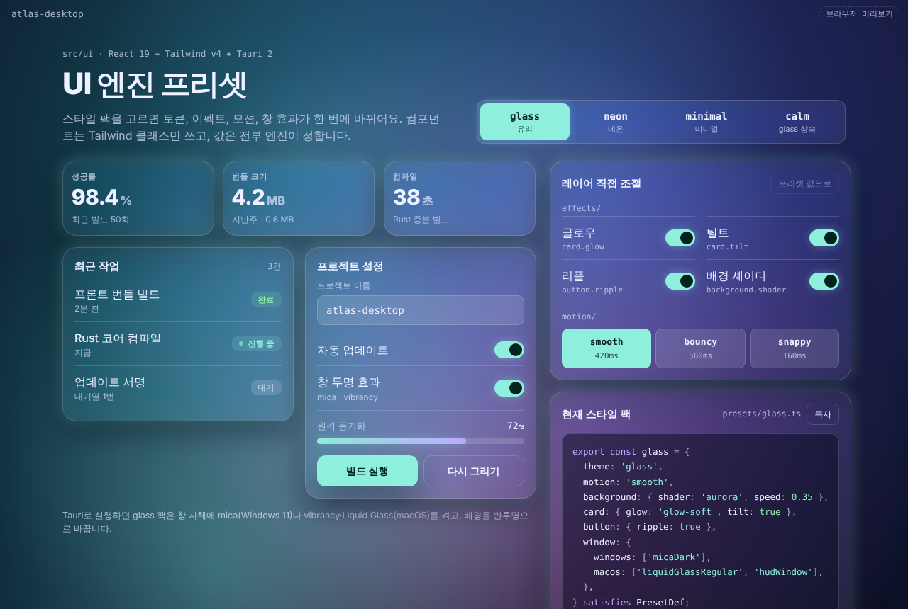
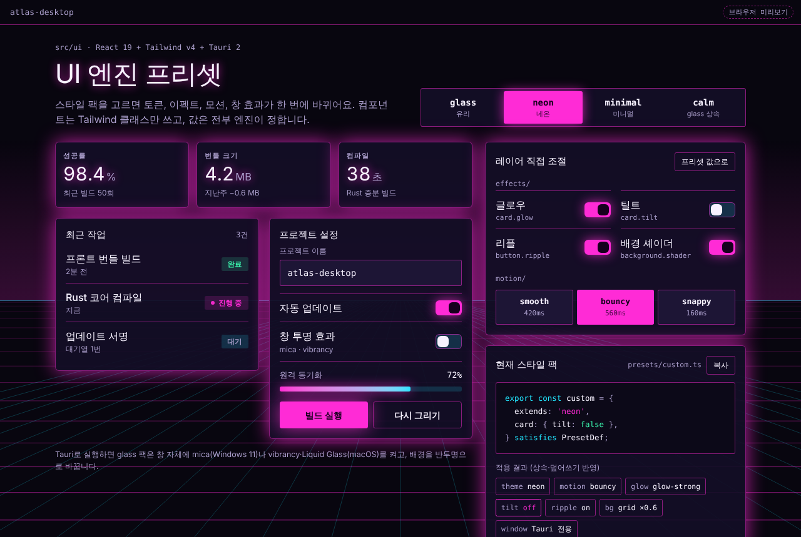
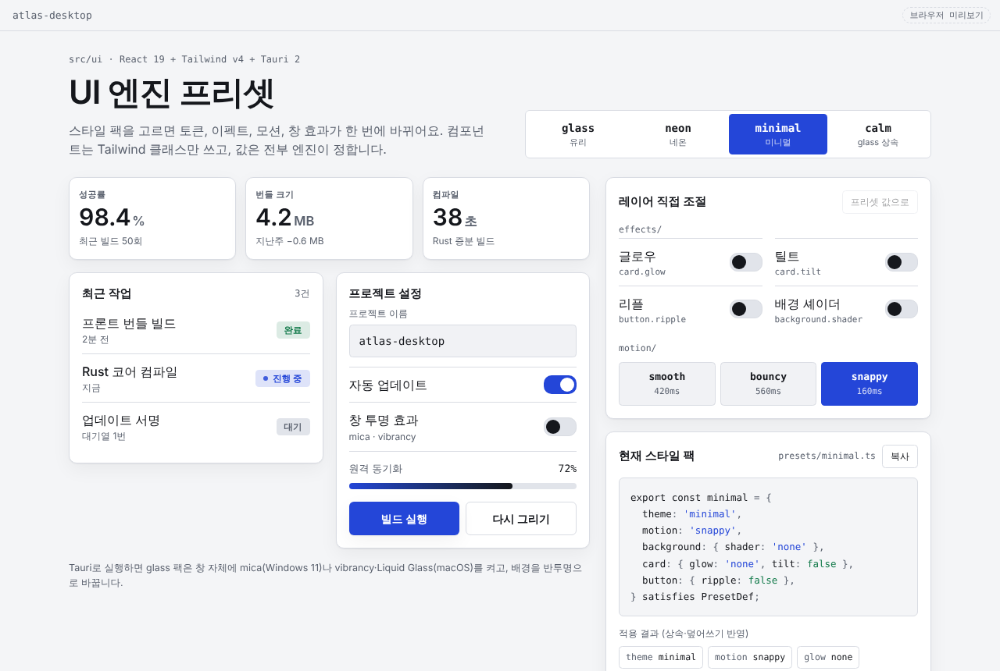

# UI 엔진 스타터 (React 19 + Tailwind CSS v4 + Tauri 2)

스타일 팩(프리셋) 하나로 토큰, 이펙트, 모션, 네이티브 창 효과를 한 번에 바꾸는 UI 레이어입니다.
컴포넌트는 Tailwind 클래스만 쓰고, 실제 값은 엔진이 `<html>`에 쓰는 `--ui-*` CSS 변수가 정합니다.
**추가 패키지는 없습니다.** react, @tauri-apps/api, tailwindcss v4만 씁니다.

| glass | neon (틸트만 끈 커스텀) | minimal |
| --- | --- | --- |
|  |  |  |

빌드 없이 바로 보려면 `demo/preset-demo.html`을 브라우저로 여세요. 같은 개념을 순수 JS로 만든 첫 데모입니다.

## 구성

```
src/ui/
├─ ui.css               Tailwind 연결 (@theme inline, 이펙트 유틸리티)
├─ engine/              UIProvider, useUI, extends 상속 해석, CSS 변수 적용
├─ themes/              glass · neon · minimal 토큰 세트
├─ presets/             스타일 팩 (calm = glass 상속 예시)
├─ effects/             useTilt, useRipple, ShaderBackground, 글로우 프리셋
├─ motion/              smooth · bouncy · snappy, <Stagger>/<Reveal>
├─ components/          Card, Button, Switch, Chip, PresetSwitcher
├─ tauri/               Titlebar, 창 효과(mica · vibrancy · Liquid Glass)
└─ dev/PresetInspector  레이어 조절 + 프리셋 코드 복사 (개발용)
src/App.tsx             사용 예시 화면
tauri-snippets/         tauri.conf.json, macOS 설정, 권한
demo/preset-demo.html   빌드 없이 여는 순수 JS 데모
docs/screenshots/       README 스크린샷
```

## 1. 데모부터 보기

```bash
npm install
npm run dev        # 브라우저에서 http://localhost:1420
```

Tauri 창 효과까지 보려면 아래 2~3단계를 기존 Tauri 프로젝트에 적용한 뒤 `npm run tauri dev`로 실행하세요.

## 2. 기존 앱에 붙이기

1. `src/ui` 폴더를 앱의 `src/` 아래로 복사합니다.
2. 메인 CSS(예: `src/index.css`)를 이렇게 시작합니다.

   ```css
   @import "tailwindcss";
   @import "./ui/ui.css";
   ```

   `src/ui`를 `src` 밖(모노레포 `packages/ui` 등)에 두면 Tailwind가 클래스를 찾도록 `@source "../packages/ui/src";`를 추가하세요.

3. `main.tsx`에서 앱을 감쌉니다.

   ```tsx
   import { UIProvider, presets } from './ui';

   <UIProvider presets={presets} defaultPreset="glass">
     <App />
   </UIProvider>
   ```

4. 화면에서 씁니다.

   ```tsx
   import { Card, Button, ShaderBackground, Titlebar, PresetSwitcher } from './ui';

   <ShaderBackground />                      {/* 앱에 한 번 */}
   <Titlebar title="내 앱" />
   <Card className="p-4">프리셋을 따라 글로우·틸트가 붙어요</Card>
   <Card glow="glow-strong" tilt={false}>이 카드만 따로</Card>
   <div className="rounded-ui border border-line bg-surface text-fg">기존 마크업도 클래스만 바꾸면 됩니다</div>
   ```

### 엔진과 연결된 Tailwind 클래스

| 종류 | 클래스 |
| --- | --- |
| 색 | `bg-bg` `bg-surface` `bg-surface-2` `border-line` `text-fg` `text-muted` `bg-accent` `text-accent-2` `text-on-accent` `text-ok` `bg-track` `bg-code` (모두 `/15` 같은 투명도 가능) |
| 모서리 | `rounded-ui` `rounded-ui-sm` `rounded-ui-xs` |
| 글꼴 | `type-display` `type-heading` `label-caps` `font-body` `font-mono` |
| 이펙트 | `glow` `glow-sm` `text-glow` `ui-backdrop` `ui-shadow`, `tilt sheen`(useTilt와 함께) |
| 모션 | `transition`, `transition-colors` 등은 자동으로 프리셋 속도·곡선을 따릅니다. `ease-ui`도 있어요 |
| 명암 | `dark:` 접두사가 OS 설정 대신 프리셋 명암을 따릅니다. 앱에 이미 dark 변형을 정의했다면 `ui.css`의 `@custom-variant` 줄을 지우세요 |

## 3. Tauri 설정

`tauri-snippets/` 파일을 참고해 `src-tauri/`에 반영하세요.

- **tauri.conf.json**: 창을 `decorations: false`, `transparent: true`, `visible: false`로 바꿉니다. UIProvider가 첫 렌더 뒤에 창을 보여줘서 흰 화면 깜빡임이 없어요.
- **tauri.macos.conf.json**: macOS에서만 병합되는 파일입니다. 신호등 버튼을 그대로 두고(`titleBarStyle: "Overlay"`) 웹 화면을 타이틀바 아래까지 올립니다. Titlebar 컴포넌트가 그 자리를 비워 둬요.
- **capabilities/default.json**: 창 이동, 최소화·최대화·닫기, 표시, 창 효과, 창 테마 권한을 추가합니다. 빠지면 콘솔에 어떤 권한이 필요한지 경고가 나옵니다.
- Tauri 2.12 미만이고 macOS 투명 창을 쓴다면 `app.macOSPrivateApi: true`도 필요합니다. 2.12.1부터는 항상 켜져 있어요.

### 창 효과가 동작하는 방식

프리셋의 `window` 항목이 운영체제별 효과 목록입니다. glass 팩은 이렇게 되어 있어요.

```ts
window: { windows: ['micaDark'], macos: ['liquidGlassRegular', 'hudWindow'] }
```

| 환경 | 결과 |
| --- | --- |
| Windows 11 | mica 적용 |
| Windows 10 | mica·tabbed는 건너뜁니다 (acrylic·blur는 동작) |
| macOS 26 | Liquid Glass, 이전 버전은 hudWindow vibrancy |
| Linux | 창 효과 없음, 불투명 배경 유지 |
| 브라우저 dev 서버 | 아무것도 하지 않음 |

효과가 실제로 켜졌을 때만 배경이 `bgTint`(반투명)로 바뀌고, 꺼진 환경에서는 불투명 `bg`를 씁니다. 프리셋 명암에 맞춰 `setTheme`도 호출해서 mica 색조와 신호등 영역이 같이 바뀝니다.

타이틀바 드래그는 `data-tauri-drag-region`으로 처리합니다. Tauri 2.11 이상이면 `data-tauri-drag-region="deep"`으로 자식 요소까지 드래그 영역으로 만들 수 있어요.

## 4. 스타일 팩 만들기

```ts
import { presets, type PresetDef } from './ui';

export const myPresets = {
  ...presets,
  ocean: { extends: 'glass', tokens: { accent: '#7cc4ff' }, motion: 'bouncy' },
} satisfies Record<string, PresetDef>;

<UIProvider presets={myPresets} defaultPreset="ocean">
```

- 새 테마는 `themes/index.ts`의 `Theme` 형태로 만들어 `<UIProvider themes={{ ...themes, sunset }}>`로 넘깁니다.
- 개발 중에는 `<PresetInspector />`에서 레이어를 바꿔 보고 **복사** 버튼으로 프리셋 코드를 얻으세요. 배포 빌드에서는 `{import.meta.env.DEV && <PresetInspector />}`처럼 빼 두세요.
- 런타임 전환은 `const { setPreset, override } = useUI();` → `setPreset('neon')`, `override('card.tilt', false)`.

## 알아둘 점

- **폰트**: 데모의 `index.html`은 Google Fonts를 링크합니다. 데스크톱 앱은 오프라인일 수 있고 Tauri CSP에 막힐 수 있으니, 실제 앱에서는 폰트 파일을 번들에 넣으세요(@fontsource 패키지 또는 woff2 + `@font-face`). 없으면 맑은 고딕·Apple SD 고딕으로 대체됩니다. 한글 폰트는 용량이 크니 쓰는 굵기만 넣으세요.
- **성능**: Linux(WebKitGTK)는 `backdrop-filter`와 캔버스 배경이 무거울 수 있어요. 필요하면 Linux에서는 minimal 같은 팩을 기본으로 고르세요.
- **저장**: 선택한 팩은 localStorage(`storageKey`)에 저장됩니다. Tauri store 플러그인으로 바꾸려면 `UIProvider.tsx`의 load/save만 교체하면 됩니다.
- **접근성**: OS의 '동작 줄이기'가 켜져 있으면 틸트, 리플, 등장 애니메이션, 배경 애니메이션이 멈춥니다.
- `cn()`은 클래스를 단순히 이어 붙입니다. 같은 속성이 겹칠 때 뒤의 클래스가 이기게 하려면 tailwind-merge로 바꾸세요.

## 확인한 범위

Tailwind CSS 4.3.3으로 CSS를 컴파일하고, React 19.2 + TypeScript 6.0으로 타입 검사를 했습니다. Tauri API는 2.12.4 소스를 기준으로 맞췄고, Chromium에서 네 가지 팩과 좁은 창 레이아웃을 렌더해 봤습니다. 실제 Tauri 창에서의 mica·vibrancy는 이 환경에서 실행할 수 없어 확인하지 못했습니다.
